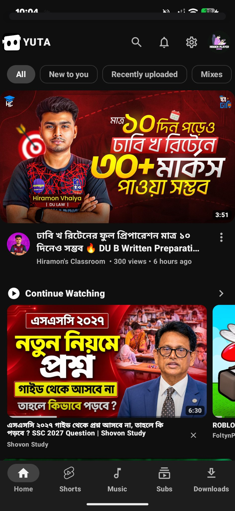
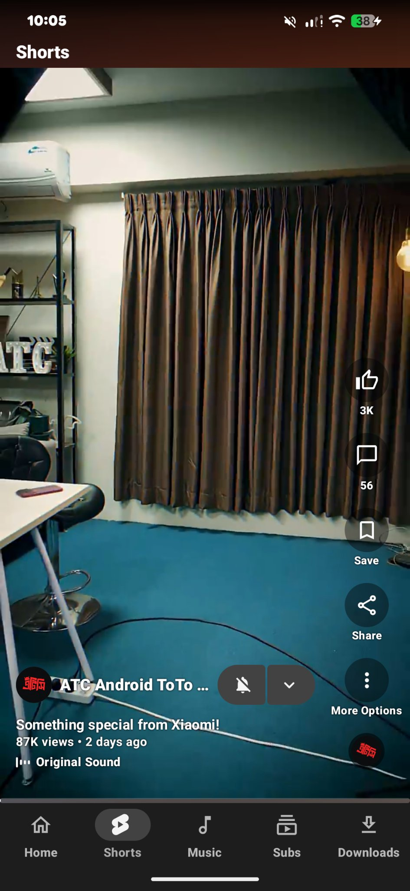
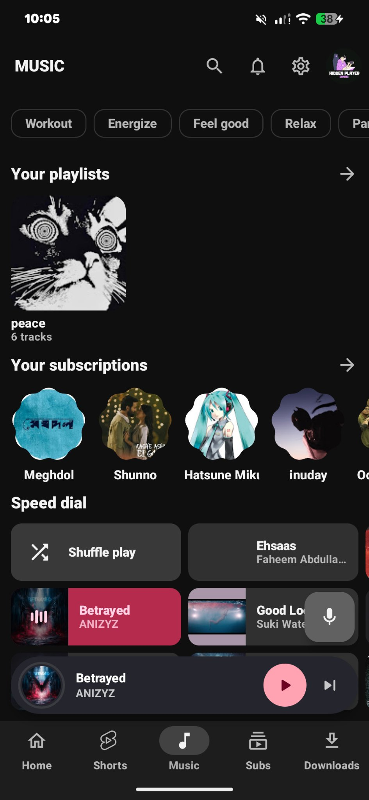
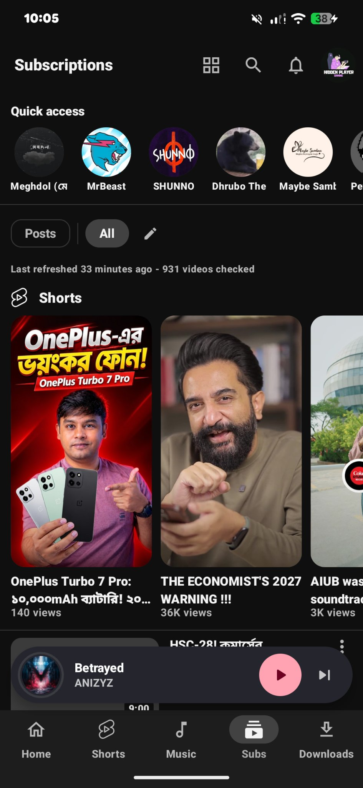
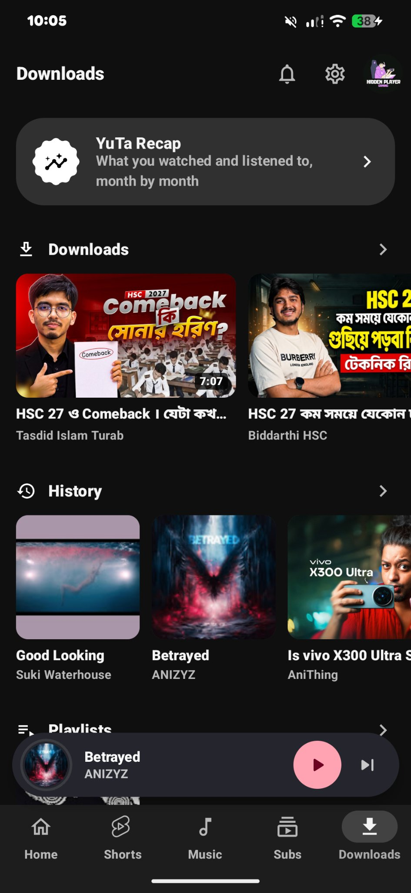
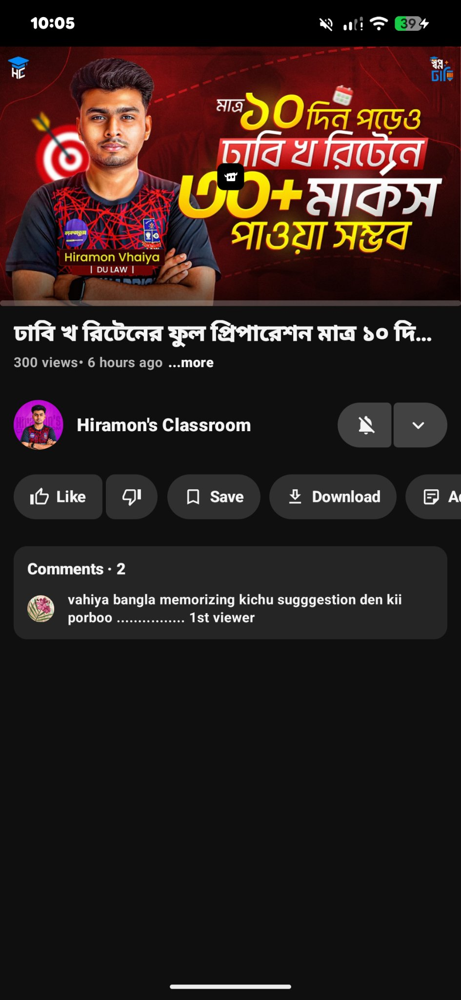
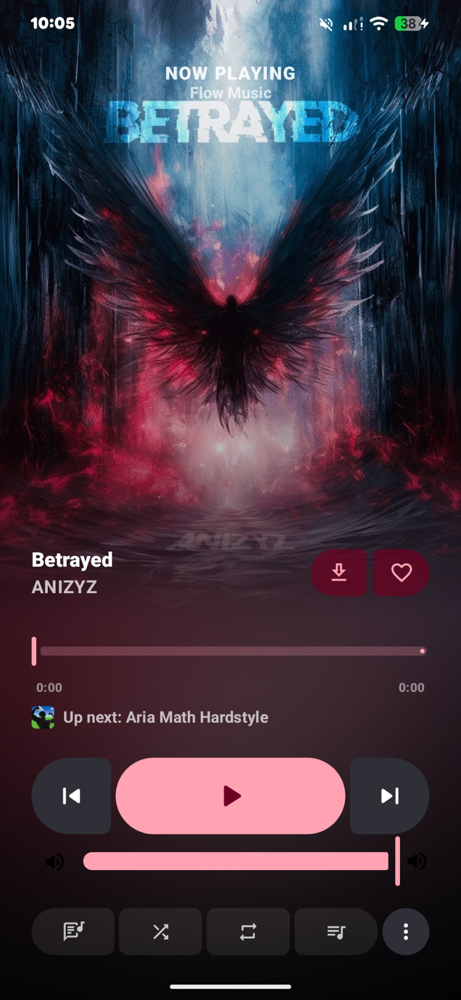
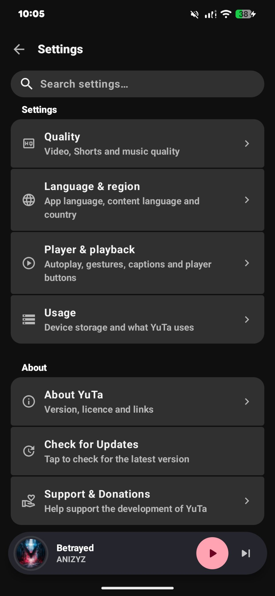
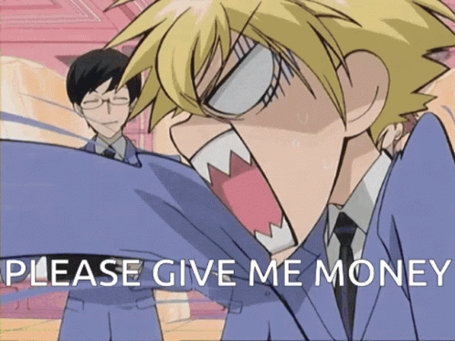
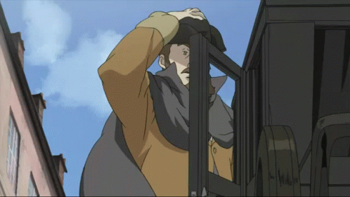

# YuTa

> YouTube and YouTube Music, without the ads.

🌐 Website: [yu-ta.pages.dev](https://yu-ta.pages.dev)

**Completely free. No ads, ever.**

## About

I got tired of the ads on YouTube, so I built my own app to watch and listen without them.

YuTa is YouTube and YouTube Music in one place. Sign in with your Google account and your history, subscriptions, liked videos and library come with you. No ads, no tracking, and it doesn't collect any of your info.

It's a hobby project I built from a few open-source projects, and I hope you like it.

## What it does

- Watch YouTube videos, no ads
- Listen to YouTube Music, no ads
- Your history, subscriptions, liked videos and library, synced from your Google account
- Download videos and songs to keep
- Background play, with lyrics
- Find a song by listening to it

## Screenshots

  <table>
    <tr>
      <td align="center"><b>Home</b> </td>
      <td align="center"><b>Shorts</b> </td>
      <td align="center"><b>Music</b> </td>
    </tr>
    <tr>
      <td align="center"><b>Subscriptions</b> </td>
      <td align="center"><b>Downloads</b> </td>
      <td align="center"><b>Video Player</b> </td>
    </tr>
    <tr>
      <td align="center"><b>Music Player</b> </td>
      <td align="center"><b>Settings</b> </td>
      <td align="center"></td>
    </tr>
  </table>

## Download

Android 8 and newer. Tap the button and the download starts right away.

## If it helped you

If YuTa made your YouTube time better, give the project a star and share it with someone else who is tired of the ads. It costs nothing, and it keeps this little project alive.

  

  

Free forever, with no ads. A little support keeps it alive — and free for everyone.

---

  

## Hats off to the open-source developers

YuTa only exists because of the developers who work on open-source projects and share what they build with everyone online. Their help, their contributions — that's what made this app possible. They are the heroes who don't wear capes.
